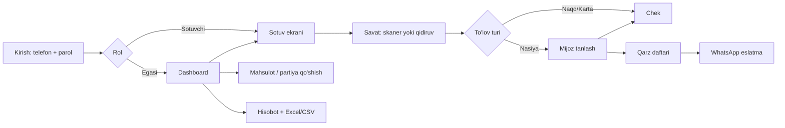

# 01 — TZ va Talablar: Mening Bozorim (my_market)

| Maydon | Qiymat |
|---|---|
| Versiya | 1.0 (koddan qayta tiklangan — reverse-engineered) |
| Sana | 2026-11-02 |
| Muallif | Abuzafar Eshboboyev |
| Manba | `feat/celery-redis` branch, commit `367b109` + ishchi daraxt |
| Holat | Review |

> Bu hujjat mavjud koddan tiklangan: har bir talab amalda ishlaydigan
> funksiyaga va testga tayanadi. Koddagi izohlar havola qiladigan "TZ v2"
> hujjati repoda yo'q — bu versiya uning o'rnini bosadi.

---

## 1. Loyiha pasporti

### 1.1 Muammo
Kichik do'konlar (oziq-ovqat, mahalla do'koni, bozordagi rasta) savdo, qoldiq
va nasiyani daftarda yoki xotirada yuritadi. Natijada:
- qaysi mahsulot qancha qolgani, qachon tugashi, muddati o'tishi noma'lum;
- foyda hisoblanmaydi — tannarx partiyaga qarab o'zgaradi, sotuvchi buni bilmaydi;
- nasiya (qarz) daftari yo'qoladi, mijozga eslatish qo'lda;
- kassa ko'pincha telefon — kompyuter, internet va svet doim bo'lmaydi.

### 1.2 Yechim
Telefon va kompyuterda ishlaydigan PWA kassa: shtrix-kod bilan sotuv,
partiya (FIFO) asosida qoldiq va foyda, mijozlar qarz daftari, kun / hafta /
oy hisobotlari Excel/CSV ga eksport, qarzdorlarga WhatsApp eslatma.

### 1.3 Maqsadlar (Goals)
| ID | Maqsad | Metrika | Nishon |
|---|---|---|---|
| G-01 | Tez sotuv | Bitta chekni yopish vaqti | ≤ 10 soniya (skaner + `Ctrl+Enter`) |
| G-02 | Aniq foyda | Foyda = sotuv − partiya tannarxi | Har chek, har qator bo'yicha |
| G-03 | Qoldiq hech qachon minusga tushmaydi | Manfiy `qty_remaining` | 0 ta (DB CHECK) |
| G-04 | Nasiya nazorati | Qarzdorlar ro'yxati va jami | Real vaqtda |
| G-05 | Ikki marta yozilmaslik | Qayta yuborilgan chek | Bir xil `client_id` → bitta sotuv |

### 1.4 Non-goals (loyiha QILMAYDI)
- NG-01: Onlayn do'kon / mijoz uchun buyurtma sahifasi.
- NG-02: Soliq kassasi (OFD / fiskal chek) bilan integratsiya.
- NG-03: Onlayn to'lov qabul qilish (Payme, Click) — karta faqat "to'lov turi" sifatida belgilanadi.
- NG-04: Bir nechta ombor / filiallar orasida tovar ko'chirish.
- NG-05: Yetkazib beruvchilar bilan hisob-kitob (kreditorlik).
- NG-06: Ochiq ro'yxatdan o'tish — do'kon admin buyrug'i bilan yaratiladi.

### 1.5 Cheklovlar
- Pul — butun so'm (`BigInteger`), tiyin yo'q. Miqdor — `Decimal(12,3)` (kg, litr).
- Vaqt zonasi — `Asia/Tashkent`; "bugun" har doim do'kon sanasi.
- Kamera / skaner faqat HTTPS (secure context) da ishlaydi.
- WhatsApp — Meta Cloud API, faqat mijoz roziligi bilan.

---

## 2. Foydalanuvchi rollari (Permissions Matrix)

Rollar: **Mehmon** (tizimga kirmagan), **Sotuvchi** (`seller`), **Egasi** (`owner`),
**Superadmin** (Django admin, `is_staff`). Har bir foydalanuvchi faqat
o'z do'koni ma'lumotini ko'radi (multi-tenant: barcha so'rovlar `shop` bo'yicha filtrlanadi).

| Resurs / Amal | Mehmon | Sotuvchi | Egasi | Superadmin |
|---|---|---|---|---|
| Kirish / refresh / chiqish | ✅ | ✅ | ✅ | ✅ |
| Mahsulot, kategoriya: ko'rish, qidirish | ❌ | ✅ | ✅ | ✅ |
| Mahsulot: yaratish, tahrirlash, arxivlash, o'chirish | ❌ | ❌ | ✅ | ✅ |
| Partiya qabul qilish, hisobdan chiqarish | ❌ | ❌ | ✅ | ✅ |
| Xarid ro'yxati (tugayotganlar) | ❌ | ❌ | ✅ | ✅ |
| Sotuv qilish | ❌ | ✅ | ✅ | ✅ |
| Sotuvni bekor qilish | ❌ | faqat o'zi qilgan va shu kungi | ✅ har qanday | ✅ |
| Mijoz, qarz, to'lov yozish | ❌ | ✅ | ✅ | ✅ |
| Hisobotlar, dashboard, eksport | ❌ | ❌ | ✅ | ✅ |
| Do'kon sozlamalari, WhatsApp sozlamalari | ❌ | ❌ | ✅ | ✅ |
| Do'kon / foydalanuvchi yaratish | ❌ | ❌ | ❌ | ✅ (CLI: `create_shop`, `add_user`) |

---

## 3. Funksional talablar

### Modul: Auth (`apps/shops`)

#### FR-01 — Telefon va parol bilan kirish `[MVP]` ✅
- **User Story:** Sotuvchi sifatida telefon raqamim va parolim bilan kirmoqchiman, toki kassani ochaman.
- **Kirish:** `phone: string` (`+998XXXXXXXXX`, boshqa yozilishlar normallashtiriladi), `password: string (≤128)`.
- **Biznes mantiq:** 1) telefon normallashtiriladi; 2) blok tekshiriladi (telefon + IP bo'yicha); 3) parol tekshiriladi; 4) access token (30 daqiqa) javobda, refresh token (30 kun) `httpOnly` cookie'da.
- **Acceptance Criteria:**
  - [x] Given to'g'ri parol When `POST /api/auth/login/` Then `200`, `data.access`, cookie o'rnatiladi.
  - [x] Given ketma-ket noto'g'ri urinishlar When limitdan oshsa Then shu telefon (va telefon + IP) vaqtincha bloklanadi; umumiy throttle `10/min` dan oshsa `429`.
  - [x] Given faol bo'lmagan foydalanuvchi Then kira olmaydi.
- **Bog'liq:** `User`, `apps/shops/security.py`, throttle `login: 10/min`.

#### FR-02 — Tokenni yangilash va chiqish `[MVP]` ✅
- Refresh har safar aylanadi (rotation), eskisi qora ro'yxatga tushadi. `POST /api/auth/refresh/`, `POST /api/auth/logout/`.

#### FR-03 — Do'kon sozlamalari `[MVP]` ✅
- `GET/PATCH /api/settings/` — do'kon nomi, telefon, manzil, `expiry_warn_days`, valyuta. Faqat egasi o'zgartiradi.

### Modul: Katalog (`apps/catalog`)

#### FR-04 — Mahsulot va kategoriya `[MVP]` ✅
- **Kirish:** `name`, `category`, `barcode` (do'kon ichida unikal), `unit` (`piece|kg|liter`), `markup_amount`, `min_stock`, `image`.
- **Biznes mantiq:** sotilgan mahsulot o'chirilmaydi — arxivlanadi (`POST /api/products/{id}/archive/`). Shtrix-kod bo'yicha qidirish (`.../barcode/`). `?ids=` bilan bir nechta mahsulotni olish (savatni qayta tekshirish uchun).
- **AC:** [x] boshqa mahsulotga biriktirilgan shtrix-kod rad etiladi; [x] dona mahsulotga kasr miqdor kiritilmaydi.

#### FR-05 — Partiya (FIFO) qabul qilish `[MVP]` ✅
- **Kirish:** `product`, `qty_initial`, `cost_price`, `sale_price`, `produced_at`, `expires_at`.
- **Biznes mantiq:** qoldiq saqlanmaydi — partiyalarning `qty_remaining` yig'indisi. Sotuvda eng eski partiya birinchi olinadi (`FIFO_ORDER`).
- **AC:** [x] `qty_remaining` 0 dan kichik va `qty_initial` dan katta bo'la olmaydi (DB CHECK).
- **Endpoint:** `POST /api/batches/`, `GET/PATCH /api/batches/{id}/`, `GET /api/products/{id}/batches/`.

#### FR-06 — Hisobdan chiqarish (write-off) `[MVP]` ✅
- Sabablar: `expired`, `damaged`, `lost`, `other`. Tannarx yo'qotish sifatida hisobotga tushadi. `POST /api/batches/{id}/writeoff/`.

#### FR-07 — Tugayotgan va muddati o'tayotgan mahsulotlar `[MVP]` ✅
- `min_stock` dan past qolganlar xarid ro'yxatida (`GET /api/purchase-list/`); `expiry_warn_days` ichida muddati tugaydiganlar dashboardda.

### Modul: Sotuv (`apps/sales`)

#### FR-08 — Sotuv (checkout) `[MVP]` ✅
- **Kirish:** `client_id: uuid` (klient yaratadi), `items[]` (≤100 qator: `product`, `qty`), `payment_type` (`cash|card|debt`), nasiya bo'lsa `customer`.
- **Biznes mantiq:** 1) bir xil `client_id` qayta kelsa — asl sotuv qaytariladi (idempotent); 2) qatorlar mahsulot bo'yicha birlashtiriladi; 3) partiyalar qat'iy tartibda bloklanadi (`SELECT … FOR UPDATE`, deadlock yo'q); 4) FIFO bo'yicha yechiladi, har qatorga `unit_cost` yoziladi; 5) nasiya bo'lsa `DebtEntry(debt)` va `debt_balance` oshadi.
- **AC:**
  - [x] qoldiqdan ko'p sotilsa → xato, hech narsa yozilmaydi;
  - [x] tarmoq uzilib qayta yuborilsa → bitta chek;
  - [x] ikki kassa bir vaqtda oxirgi tovarni sotsa → faqat bittasi o'tadi.
- **Endpoint:** `POST /api/sales/`, `GET /api/sales/`, `GET /api/sales/{id}/`.

#### FR-09 — Sotuvni bekor qilish `[MVP]` ✅
- Tovar o'z partiyasiga qaytadi, nasiya bo'lsa qarz kamayadi (lekin "to'lov" deb hisoblanmaydi). Ikki marta bekor qilish xavfsiz (row lock). Huquq — §2 jadvali. `POST /api/sales/{id}/cancel/`.

### Modul: Nasiya (`apps/debt`)

#### FR-10 — Mijozlar va qarz daftari `[MVP]` ✅
- Mijoz: `full_name`, `phone`, `note`. `debt_balance` — qarz qoldig'i.
- Yozuvlar: `debt` (nasiya sotuv yoki qo'lda) va `payment` (to'lov), `due_date` (to'lov muddati).
- Faqat qarzdorlar filtri, ism yoki telefon bo'yicha qidirish, "kim qancha qarz" jamlanmasi.
- **Endpoint:** `/api/customers/` CRUD, `POST .../{id}/debt/`, `POST .../{id}/payment/`, `GET /api/customers/summary/`.
- **AC:** [x] to'lov qarzdan katta bo'lishi mumkin — mijoz haqdor bo'lib qoladi (`debt_balance < 0`), UI oldin ogohlantiradi; [x] jami faqat `debt_balance > 0` mijozlarni sanaydi.

### Modul: Hisobotlar (`apps/reports`)

#### FR-11 — Dashboard `[MVP]` ✅
- `GET /api/dashboard/` — bugungi tushum, foyda, cheklar soni, tugayotgan va muddati o'tayotgan mahsulotlar.

#### FR-12 — Davr hisoboti `[MVP]` ✅
- `GET /api/reports/?period=day|week|month&date=YYYY-MM-DD`.
- Tarkibi: tushum, foyda, cheklar soni, o'rtacha chek, o'tgan davr bilan solishtirish, kunlik (kun davri uchun soatlik) qatorlar, sotilgan har bir mahsulot, naqd/karta/nasiya taqsimoti, nasiya holati, hisobdan chiqarishlar.
- **AC:**
  - [x] hafta dushanbadan boshlanadi; kelajakdagi sana bugunga tortiladi;
  - [x] bekor qilingan sotuvlar hisobga kirmaydi;
  - [x] hafta yoki oy endigina boshlangan (1 kun) bo'lsa ham qatorlar **kunlik** bo'ladi (2026-11-02 da tuzatildi).

#### FR-13 — Eksport `[MVP]` ✅
- CSV — darhol, `GET /api/reports/export/` (UTF-8 BOM, `;` ajratuvchi).
- Excel (4 varaq: Xulosa, Kunlar/Soatlar, Barcha sotuvlar, Mahsulotlar) — Celery vazifasi: `POST /api/reports/export/` → `202` + job; holat va yuklab olish do'konni tekshiradigan view orqali; eski fayllar har soat o'chiriladi.
- Sotilmagan mahsulotlar eksporti: `GET /api/reports/unsold/export/`.

### Modul: WhatsApp (`apps/notifications`) — `[v1.1]` ✅ (token berilmasa o'chiq)

#### FR-14 — Mijoz roziligi
- Rozilik / bekor qilish va uning tarixi (`ConsentEvent`). Rozilik bo'lmasa xabar yuborilmaydi. `.../{id}/whatsapp-consent/`.

#### FR-15 — Qarz eslatmalari
- Avtomatik: muddatdan `reminder_days_before` kun oldin va muddati o'tgach har `overdue_repeat_days` kunda, ko'pi bilan `max_reminders_per_debt` marta, faqat `send_window_start…end` oralig'ida (Celery beat, 15 daqiqa).
- Qo'lda: `POST /api/customers/{id}/send-reminder/` — bir mijozga kuniga bittadan ko'p emas.

#### FR-16 — Webhook
- `/api/whatsapp/webhook/` — imzo tekshiriladi, kiruvchi xabar va yetkazish statuslari yoziladi, qayta kelgan hodisa takrorlanmaydi.

---

## 4. Foydalanuvchi oqimi

---

## 5. Nofunksional talablar (NFR)

| ID | Kategoriya | Talab | Holat |
|---|---|---|---|
| NFR-01 | Yuklama | Har bir foydalanuvchi uchun 600 so'rov/min, yozish 120/min, mehmon 30/min, eksport 12/min | ✅ throttle |
| NFR-02 | Latency | Sotuv va hisobot so'rov ichida og'ir ish qilmaydi (Excel — Celery'da) | ✅ (o'lchov yo'q) |
| NFR-03 | Mavjudlik | `GET /healthz/` healthcheck; Docker restart siyosati | ✅ / SLA belgilanmagan |
| NFR-04 | Xavfsizlik | HTTPS majburiy, HSTS, CSP, httpOnly + SameSite cookie, login blok, kirish ma'lumotlariga yuqori chegaralar (`apps/common/limits.py`), multi-tenant izolyatsiya testlari | ✅ |
| NFR-05 | Backup | Kunlik `pg_dump` + `media/`, 14 kun saqlash, RPO 24 soat; oylik tiklash mashqi | ✅ `backup` servisi, `docs/BACKUP.md` (server tashqarisiga nusxa — operator vazifasi) |
| NFR-06 | Kuzatuv | Log satrida `[request_id]`, xatolar monitoringi (Sentry), `/healthz/` va `/healthz/celery/` | ✅ Sentry `SENTRY_DSN` bilan yoqiladi |
| NFR-07 | Lokalizatsiya | O'zbek (lotin) va rus, ish paytida almashtiriladi | ✅ |
| NFR-08 | Moslashuvchanlik | 320px telefondan keng monitorgacha, PWA | ✅ |
| NFR-09 | Sifat | CI: ruff, format, migratsiya, backend testlar (chekka sanalarda ham), backup skript testlari, `pip-audit`, Vitest, `npm audit`, build; dependabot | ✅ |

---

## 6. Edge-cases

| # | Holat | Kutilgan xatti-harakat | Holat |
|---|---|---|---|
| E-01 | Internet uzilib, chek qayta yuborildi | Bir xil `client_id` → asl sotuv qaytadi | ✅ |
| E-02 | Ikki kassa oxirgi donani bir vaqtda sotadi | Bittasi o'tadi, ikkinchisi "qoldiq yetarli emas" | ✅ |
| E-03 | Brauzerda saqlangan savatdagi mahsulot arxivlangan / tugagan | Savat qayta tekshiriladi, qator olib tashlanadi yoki miqdor qoldiqqa tushiriladi | ✅ |
| E-04 | Server UTC'da, Toshkentda 00:00–05:00 | "Bugun" — do'kon sanasi | ✅ |
| E-05 | Nasiya sotuv bekor qilindi | Qarz kamayadi, lekin "to'lov" emas | ✅ |
| E-06 | Haddan katta son (`qty=10^11`) | `400 VALIDATION_ERROR`, 500 emas | ✅ |
| E-07 | Dushanba kuni haftalik / 1-sanada oylik hisobot | Kunlik qatorlar (soatlik emas) | ✅ 2026-11-02 da tuzatildi |
| E-08 | Excel ichiga `=CMD(...)` nomli mahsulot | Formula injection'dan himoya (`safe_cell`) | ✅ |
| E-09 | Svet / internet yo'q | Telefondan ishlash (QOLLANMA.md) | ✅ hujjatlangan; to'liq offline sotuv yo'q |

---

## 7. Taxminlar
- A-01: Bitta do'kon — bitta ombor; 1–5 ta sotuvchi.
- A-02: Narxlar butun so'mda.
- A-03: Do'konlarni xizmat ko'rsatuvchi (superadmin) qo'lda ochadi.

## 8. Ochiq savollar
- Q-01: Backup server tashqarisiga qayerga ko'chiriladi (boshqa server, bulut)? — server ichidagi kunlik backup tayyor.
- Q-02: ~~Xatolar monitoringi kerakmi?~~ — Sentry qo'shildi; DSN (hisob) kim ochadi?
- Q-03: Internetsiz to'liq offline sotuv (keyin sinxronlash) kerakmi, yoki "telefondan ishlash" yetarlimi?
- Q-04: Fiskal kassa (OFD) talab qilinadimi?

---

## 9. Bajarilish holati (2026-11-02, yangilangan)

| Modul | FR | Holat |
|---|---|---|
| Auth, sozlamalar | FR-01…03 | ✅ |
| Katalog, FIFO | FR-04…07 | ✅ |
| Sotuv | FR-08…09 | ✅ |
| Nasiya | FR-10 | ✅ |
| Hisobotlar, eksport | FR-11…13 | ✅ |
| WhatsApp | FR-14…16 | ✅ kod va testlar tayyor; ishlashi uchun Meta tokeni va tasdiqlangan shablonlar kerak |
| Backup, monitoring | NFR-05, NFR-06 | ✅ (staging'da jonli sinov kutilmoqda) |
